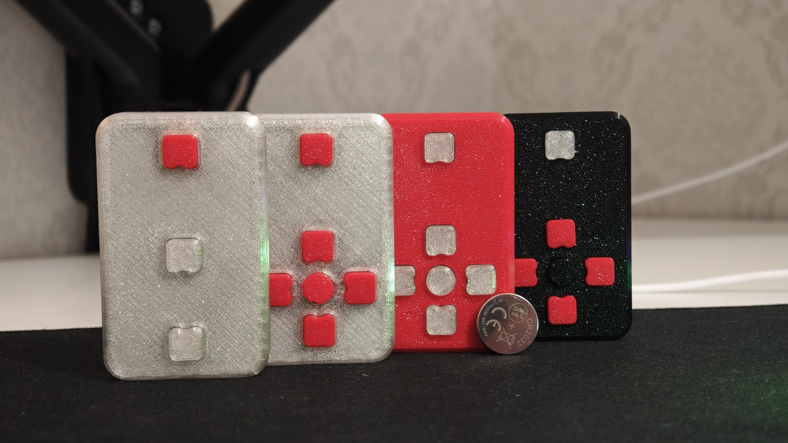

# DK Simple Remote


A small BLE HID remote built around the WCH CH583, powered by a CR2032 cell.

| Folder / file | Contents |
|---|---|
| [`KiCad/`](KiCad/) | KiCad project `dk-simple-remote`: schematic, PCB, libraries, 3D models |
| `KiCad/production/` | Fabrication outputs (Gerbers, BOM, positions) |
| [`FreeCAD/`](FreeCAD/) | Enclosure |
| `Assets/` | Component datasheets |
| [`Firmware/`](Firmware/README.md) | Firmware source; the WCH SDK is a git submodule |

Clone with the SDK:

```sh
git clone --recurse-submodules <this-repo>
```

## License

This project uses two licenses:

- **Hardware** (everything outside `Firmware/`: the `KiCad/` project,
  fabrication outputs, enclosure and 3D models) is licensed under
  [Creative Commons Attribution-NonCommercial-ShareAlike 4.0](LICENSE)
  (CC BY-NC-SA 4.0). You may build, modify and share it for non-commercial
  purposes with attribution; derivatives must use the same license.
  Selling boards, kits or devices made from this design is not permitted.
- **Firmware** (`Firmware/`) is [MIT licensed](Firmware/LICENSE). WCH SDK
  components and WCH-derived files keep their Apache-2.0 terms; see
  [third-party notices](Firmware/THIRD_PARTY_NOTICES.md).

Datasheets in `Assets/` and vendor 3D models in `KiCad/Models/` belong to their
respective manufacturers and are not covered by either license.

Copyright (c) 2026 CH583 Remote contributors.
